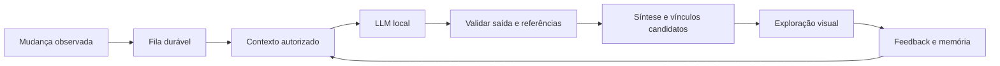

# Plano de evolução — laboratório visual e assistente local

Data: 2026-11-09. Estado: T01 e T04 concluídas; T02 em avaliação visual.
Base de código inspecionada: `7b3338e088aec0710646e35b5ad115de06302bf7`.
Entrada para outro assistente: [CONTINUIDADE.md](CONTINUIDADE.md).
Arquitetura proposta: [ADR-004](ADR-004-ASSISTENTE-LOCAL.md).

## 1. Resultado pretendido

**O LAC prepara contexto continuamente; a pessoa explora, corrige e decide.**

Assistente local acompanha acontecimentos autorizados, prepara sínteses,
propõe relações justificadas e usa memória inspecionável para melhorar a
assistência. A interface permite reconhecer mudanças, atravessar projetos,
examinar fontes e trabalhar com materiais sem depender de listas extensas.

Continuar uma trajetória é mais amplo que gerenciar tarefas: inclui versões,
decisões, retificações, relações e lacunas de informação. Os compromissos
REA/RIT/MPRR permanecem conforme [fundamentos](LAC-BASES-001_v0.1.0.md).

## 2. Estado real e lacunas

Disponível na base inspecionada:

- C++26, SQLite, eventos encadeados append-only, observação Git/documentos.
- Notas, decisões, pendências, relações entre projetos, API e ponte MCP.
- Autenticação institucional, LAN e serviço systemd com linger.
- Adaptadores opcionais Recoll e ActivityWatch; consultas não importam tudo.
- Captura rápida, cartão de continuidade e síntese por regras na interface.

Ainda não disponível:

- Provedor local de LLM no produto, fila de automação ou memória do assistente.
- Relações genéricas entre documentos, revisões, decisões e acontecimentos.
- Canvas persistente, perspectivas sincronizadas ou revisão visual integrada.
- Extração geral do conteúdo de PDFs/DOCX pelo observador.

Pontos encontrados no código:

- `src/core.cpp`: relações usam `from_project`/`to_project`; eventos aceitam
  `observed`, `declared`, `proposed`; o schema está na versão 1.
- `/api/events` limita a 200 e ordena por ocorrência. O briefing solicita 300,
  mas recebe até 200. Uma fila não pode usá-lo como feed completo.
- `src/server.cpp`: autoria LLM atual depende de `X-LAC-Agent: mcp` e da
  referência `llm:mcp:`. Worker novo exige atribuição explícita compatível.
- `scripts/lac_briefing.py` e `web/app.js`: sínteses são agrupamentos por regras,
  sem inferência. Alguns textos inferem sucesso pela ausência de registros;
  corrigir essa linguagem ao integrar a nova síntese.
- E-mails institucionais verificados compartilham o laboratório. Preferências
  individuais e permissões do worker ainda precisam de contratos próprios.

## 3. Experiência a projetar

Um contexto selecionado, quatro perspectivas sincronizadas:

- **Laboratório:** frente em foco, frentes relacionadas, mudanças preparadas
  pela automação e questões abertas explicitamente registradas.
- **Trajetória:** acontecimentos, versões e revisões; escala por período e
  agrupamento por frente. Ordem temporal não representa causalidade.
- **Conexões:** vizinhança de uma seleção, expansão progressiva, vínculos
  rotulados, filtros por tipo, estado, origem e período.
- **Bancada:** materiais fixados, comparação e criação explícita de vínculos.

Trocar perspectiva preserva seleção, filtros e caminho de navegação. Retomar
uma sessão restaura o contexto permitido. Layout fixado pela pessoa não muda
silenciosamente quando a automação encontra novos dados.

Assistente tem presença discreta, ações junto da seleção e painel contextual.
Pode explicar uma relação, comparar materiais, preparar síntese e sugerir ação.
Texto longo, proveniência e datas ficam no painel de detalhe. Cada objeto
mantém identidade visual entre perspectivas. Relação candidata, confirmação
humana e simples proximidade espacial têm sinais distintos além da cor.

Zoom revela detalhes progressivamente; oferecer voltar, enquadrar seleção e
ver conjunto. Interações precisam de teclado, foco visível e alternativas por
clique ao arrastar. Avaliar telas pequenas e movimento reduzido.

## 4. Fluxo funcional de referência



Primeiro percurso completo: nota ou Markdown muda; LAC reúne contexto, produz
síntese e proposta fundamentada; pessoa compara fontes, confirma ou corrige;
a revisão entra na trajetória e informa próximas consultas.

O protótipo deve identificar dados simulados. Implementação real começa com
texto de notas e mensagens Git. Conteúdo de arquivos entra apenas pelo
recuperador autorizado; título ou hash de um PDF não permite resumir seu texto.

## 5. Memória e automação

### Memória

- Episódica: referências a acontecimentos, decisões e correções.
- Preferências: escolhas explícitas de apresentação, foco e rotinas.
- Feedback: aceitação, descarte, correção e justificativa quando fornecida.
- Procedimentos: rotinas previamente autorizadas com escopo e limites.

Cada item precisa de identificador, escopo, proprietário, origem, revisão,
estado e datas. Memória pessoal não entra no contexto compartilhado sem
autorização. Vincular proprietário à identidade autenticada, nunca a campo
livre enviado pelo cliente. O laboratório atual não oferece ACL por projeto;
não prometer isolamento que não foi implementado.

Revisar, desativar e inspecionar memória. Desativação invalida recuperação e
caches derivados. Eventos históricos continuam preservados. Feedback ajusta
contexto e preferências; não treina pesos nesta entrega. Medir se sugestões
melhoram; não anunciar aprendizagem apenas porque existe armazenamento.

### Automação

- Reagir a novos IDs de ingestão, inclusive commits antigos importados hoje.
- Agregar rajadas por escopo, respeitar limites de tempo/contexto/recursos.
- Chave de trabalho inclui fonte/revisão, tarefa, configuração e versões
  pertinentes; retries não podem duplicar resultados ou eventos.
- Registrar estado durável: pendente, executando, aguardando provedor,
  concluído, falhou, cancelado. Lease permite recuperar trabalho interrompido.
- Persistir entrega de resultado e checkpoint de modo recuperável; tratar
  queda depois da gravação e antes da confirmação do trabalho.
- Impedir ciclos: síntese da LLM não dispara indefinidamente novas sínteses.
- Pausar por projeto/fonte/tarefa; fonte removida ou permissão revogada deve
  invalidar trabalho/contexto antes da execução e antes da persistência.
- Referências externas são dados não confiáveis. O modelo não ganha shell,
  SQL ou novas fontes ao interpretar texto recuperado.

Inferência usa saída estruturada e validação independente. Registrar modelo e
identificador disponível, versão do prompt, fontes/revisões, tempos e limites.
Confiança numérica do modelo não deve ser apresentada como probabilidade
calibrada. Fonte existente, sozinha, não comprova fidelidade da síntese.

## 6. Etapas executáveis

Estados: `concluída`, `pendente`, `em andamento`, `bloqueada`.
Cada tarefa deve terminar com artefato revisável, evidências e ponto de retomada.
Tarefas podem ser divididas em subitens quando não couberem numa sessão.

### T00 — Registrar plano e passagem de contexto

- Estado: concluída nesta entrega de documentação.
- Artefatos: este plano, ADR-004, CONTINUIDADE, AGENTS e link no README.
- Aceite: referências locais válidas, estados consistentes e diff sem erros.

### T01 — Fechar contratos e inventário

- Estado: concluída. Dependência: T00.
- Entrega: [contratos e inventário](LAC-ASSISTENTE-CONTRATOS-001.md).
- Host confirmado pelo usuário: estação atual. Modelo inicial avaliado:
  `qwen2.5:7b`, já instalado no Ollama; ver [avaliação](avaliacoes/2026-11-09-ollama.md).
- Identificar host de inferência: estação ou labeco-srv; medir RAM, CPU,
  GPU/VRAM e espaço no host efetivo, sem assumir que são iguais.
- Especificar feed por cursor/ID, referências estáveis, relações tipadas,
  atribuição LLM, memória, fila, limites e identidade técnica do worker.
- Definir ações autorizadas por tarefa, sem reutilizar credencial
  administrativa irrestrita como solução de menor privilégio.
- Saída: contrato de API/dados com exemplos e escolha fundamentada de runtime.
- Aceite: proposta cobre reinício, autenticação sem login, migração e escopo;
  modelo só é escolhido após avaliação, sem downloads implícitos nesta tarefa.

### T02 — Protótipo visual navegável

- Estado: em andamento. Dependência: T01 nos conceitos de dados.
- Entrega: [prévia navegável](../prototypes/laboratorio/README.md), implementada
  com dados fictícios e verificada em navegador desktop/celular. Avaliação
  com pessoa usuária ainda pendente; não marcar concluída só pelos testes.
- Desenhar laboratório, vizinhança, comparação, painel do assistente e memória.
- Usar um percurso completo e dados fictícios identificados; manter seleção
  entre perspectivas. Definir arranjo, zoom e ações contextuais.
- Mostrar vazio, processamento, fila pausada, erro, fonte ausente e proposta
  descartada. Confirmar alternativa por clique/teclado ao arrastar.
- Aceite: reconhecer mudança, abrir origem e revisar vínculo sem formulário
  permanente ou lista extensa. Registrar avaliação com pessoa usuária.

### T03 — Base de dados e contratos incrementais

- Estado: concluída. Dependência: T01.
- Entrega: tabelas duráveis `continuity_jobs`, `continuity_insights`, `continuity_feedback`, endpoints `/api/assistant/insights`, `/api/assistant/jobs`, `/api/assistant/feedback`, `/api/documents` e cursor de processamento.
- Aceite: preserva IDs e cadeia SHA-256 histórica (append-only); processa eventos sem reescrever histórico.

### T04 — Adaptador de inferência local

- Estado: concluída. Dependência: T01; pode anteceder T03.
- Entrega: `scripts/lac_local_llm.py`, contrato de síntese, 16 testes simulados,
  três casos reais com dados sintéticos e instalação em prefixo temporário.
- Evidências: [avaliação local](avaliacoes/2026-11-09-ollama.md).
- Integração ao serviço e inferência contínua continuam nas tarefas seguintes.
- Adaptador Ollama com timeout, limites, cancelamento e JSON schema validado.
- Loopback, modo local, sem fallback em nuvem. Health distingue processo
  disponível de modelo carregado e pronto para inferência.
- Aceite: provedor simulado cobre sucesso, JSON inválido, timeout e falta de
  modelo; teste real separado mede qualidade em português, latência e memória.

### T05 — Fila e agendamento recuperáveis

- Estado: concluída. Dependência: T03.
- Entrega: worker autônomo recuperável `lac_continuity_worker.py` sob `lac-worker.service`, processamento durável de jobs, drenagem de cargas volumosas, prevenção de ciclos e reinício limpo sem duplicação de sínteses.
- Aceite: interrupção do daemon não corrompe o estado; tarefas finalizadas não são reprocessadas.

### T06 — Recuperação de contexto e conteúdo (Acervo & Corpus)

- Estado: concluída. Dependência: T03.
- Entrega: leitor e extrator de metadados intelectuais `scripts/lac_doc_reader.py` (LaTeX, Markdown, PDF, TXT), endpoint `/api/documents/read` restrito a raízes autorizadas, endpoint agregador `/api/documents` e visão web `#view-corpus`.
- Aceite: títulos limpos, seções e autores extraídos sem shell externo; leitura rápida e inspecionável em modal `#docDialog`.

### T07 — Primeira automação útil: síntese fundamentada

- Estado: em andamento. Dependências: T04, T05, T06.
- Sínteses de continuidade e ressonâncias conceituais ativas geradas pelo Ollama (`qwen2.5:7b`), persistidas em `continuity_insights` e exibidas no card executivo da Visão Geral com navegação e no Acervo Documental. Próximo passo: agrupamento temporal de rajadas de commits.

### T08 — Memória persistente e feedback (Princípio REA)

- Estado: concluída. Dependência: T07.
- Entrega: tabela `continuity_feedback`, endpoints GET/POST `/api/assistant/feedback`, botões de adotar e dispensar com 1 clique para relações e oportunidades, e filtro contextual para não re-propor itens descartados pela equipe.
- Aceite: decisões de descarte ou adoção gravadas sem apagar fatos históricos.
  desativação retira item de contexto/cache; usuário não lê memória pessoal
  de outro; rejeição não vira regra global automaticamente.
- Avaliar recuperação com feedback habilitado/desabilitado em conjunto fixo.

### T09 — Relações candidatas e revisão

- Estado: pendente. Dependências: T07, T03.
- Propor vínculos tipados com justificativa, direção quando aplicável e
  referências exatas; integrar confirmação, descarte e retificação.
- Aceite: LLM não confirma relações; endpoints inexistentes são rejeitados;
  revisão humana gera registro novo; repetições não inundam a interface.
- Feedback dessa revisão alimenta T08 quando disponível.

### T10 — Interface visual com dados reais

- Estado: pendente. Dependências: T02, T07, T09.
- Conectar protótipo a resultados reais; sincronizar perspectivas, seleção,
  filtros e histórico de navegação. Persistir arranjos com escopo explícito.
- Aceite: mapa local legível com expansão limitada, fontes acessíveis e
  posição fixada preservada após atualização; teclado e foco funcionam.
- Distinguir resultados ausentes, parciais, antigos e processamento em curso.

### T11 — Assistente contextual

- Estado: pendente. Dependências: T08, T10.
- Consultar seleção, comparar materiais, explicar propostas e mostrar memória.
- Iniciativa limitada às rotinas habilitadas; conversa usa contexto com fontes
  e não recebe autorização geral para executar ferramentas.
- Aceite: seleção controla contexto; explicação aponta referências utilizadas;
  preferências têm origem visível; indisponibilidade permite continuar trabalho.

### T12 — Operação, avaliação e entrega

- Estado: pendente. Dependências: T11.
- Integrar instalação e serviços com inicialização no boot e funcionamento após
  logout; preservar banco, SMTP, autenticação e configuração das integrações.
- Testar timeout de credencial, reinício, perda do modelo, disco cheio e restauração.
- Preparar atualização, backup consistente do SQLite/WAL e rollback compatível.
- Aceite: um comando mantém experiência operacional; modelo ausente é informado
  sem downloads inesperados; dados e memória persistem; documentação distingue
  testes simulados, validação local e validação no servidor.
- Atualizar README/CHANGELOG/versão apenas conforme capacidades efetivamente
  entregues; publicar commits e atualizar CONTINUIDADE conforme escopo autorizado.

## 7. Verificação e métricas

Testes atuais, em build isolado, sem instalar ou reiniciar serviço:

```bash
cmake -S . -B build -DCMAKE_BUILD_TYPE=Release -DBUILD_TESTING=ON
cmake --build build --parallel 2
ctest --test-dir build --output-on-failure
```

Os testes registrados são `lac_integration`, `lac_auth_policy` e `lac_local_llm`.
Adicionar testes dos novos contratos conforme as tarefas, com modelo/SMTP
simulados por padrão. Não usar conteúdo privado em fixtures versionadas.

Verificação visual opcional: `node tests/check_prototype.cjs`, com Playwright
disponível e a prévia local na porta 8876. `LAC_PLAYWRIGHT_MODULE` pode indicar
uma instalação externa do pacote. Capturas ficam em `.cache/prototype` (fora
do Git). Avaliação real explícita: `python3 tests/evaluate_local_llm.py --model
qwen2.5:7b`; não integra o CTest nem baixa modelos.

Conjunto de avaliação inicial: notas, alterações Markdown, mensagens Git,
retificações, documentos sem extração e relações ambíguas. Incluir conteúdo
com instruções maliciosas para verificar que não amplia ferramentas ou escopo.

Medir: tempo para localizar origem/retomar contexto, fidelidade das sínteses,
utilidade e repetição de sugestões, proporção de correções, latência e memória
no hardware real. Aceitação de proposta é sinal de uso, não medida automática
de verdade. Registrar amostra, baseline e resultado; não inventar percentuais.

## 8. Escopo e interrupções

Executar por entregas, com um checkpoint durável por tarefa e commits pequenos
conforme autorização. Treinamento e busca vetorial ficam fora da primeira
entrega; sua inclusão depende de limitação observada e avaliação específica.

Se interromper: registrar estado real, arquivos, teste exato e próximo comando
em CONTINUIDADE; deixar explícito o que está parcial. Outro assistente deve
verificar Git e artefatos antes de continuar, sem depender desta conversa.
